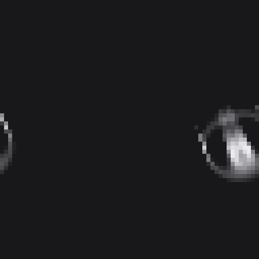
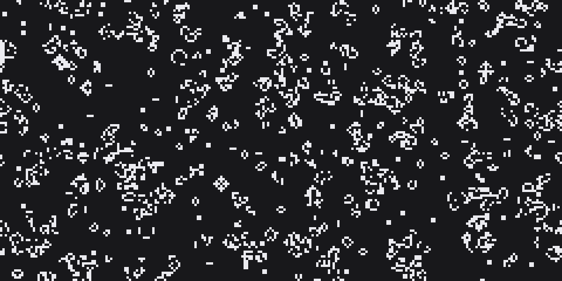
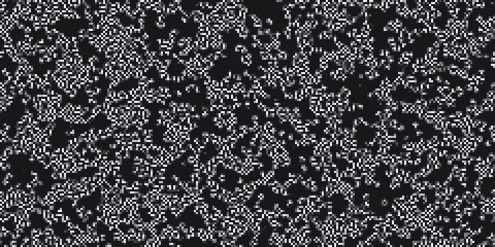
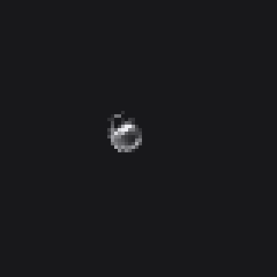
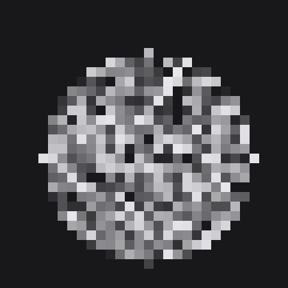

# Cellular Automata WASM

An interactive cellular automata playground in the browser. The simulation engine is written in Rust and compiled to WebAssembly, the UI is plain TypeScript with Vite.

**Live demo:** https://somniasqrt.github.io/ca-wasm/

<p align="center"></p>
<p align="center"><sub>Orbium, a classic Lenia creature (R = 13, mu = 0.15, sigma = 0.015), simulated by this engine.</sub></p>

## Modes

**Game of Life (CA).** Classic binary automaton with editable Birth/Survival rules, so you can switch from Conway's B3/S23 to any other Life-like rule.



**Kernel-based continuous CA (CCA).** A Lenia-style automaton with real-valued cell states:

- each cell sums its neighbourhood with a convolution kernel;
- the sum goes through a growth function, and the cell state is updated by a small time step and clamped to [0, 1].

Everything is editable at runtime:

- kernel radius and weights, with symmetry helpers (mirror X, mirror Y, center);
- the growth function itself, typed as a formula (for example `exp(-((x-mu)^2) / (2*(sigma^2)))`), with a live plot of its shape;
- parameters mu and sigma;
- random initial state.



<p align="center">
  
  
</p>
<p align="center"><sub>Left: one soft drop with a large ring kernel (R = 10, mu = 0.15, sigma = 0.02) shrinks into a ring, then spreads like an amoeba. Right: the polynomial bell preset settles into a blob that keeps boiling inside.</sub></p>

**GCA.** Placeholder for a future mode.

## Controls

- draw on the canvas with the mouse, adjustable brush size;
- zoom with the mouse wheel;
- play, pause, single step, simulation speed;
- grid size, reset.

## How it works

- `ca_engine/` is the Rust crate. It keeps the grid in WASM memory and exposes `step()` and setters through `wasm-bindgen`. The JS side reads the cells directly through a pointer into WASM memory, without copying.
- The grid wraps around at the edges (toroidal topology).
- The continuous mode uses a double buffer, so a step never reads cells it has already updated.
- Growth functions are parsed at runtime with the `meval` crate.

## Run locally

Requirements: Rust, [wasm-pack](https://rustwasm.github.io/wasm-pack/), Node.js.

```bash
cd ca_engine
wasm-pack build --target web

cd ../web
npm install
npm run dev
```